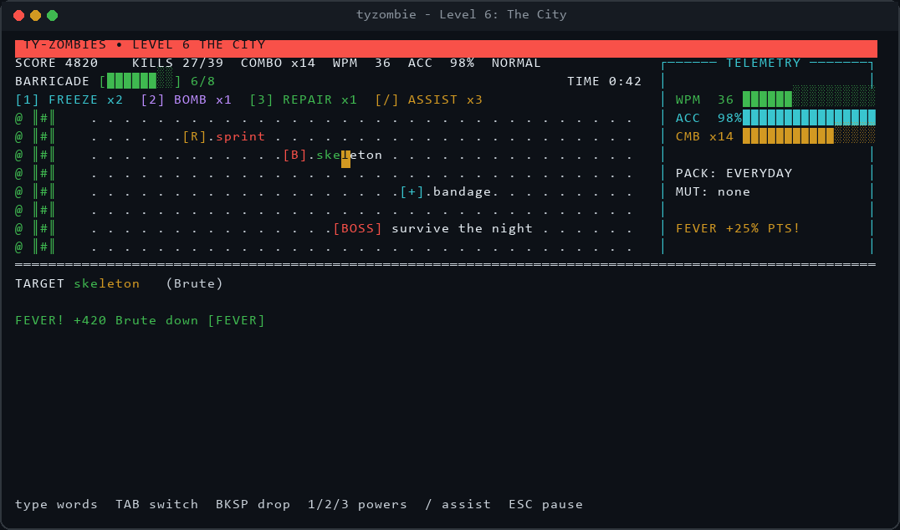
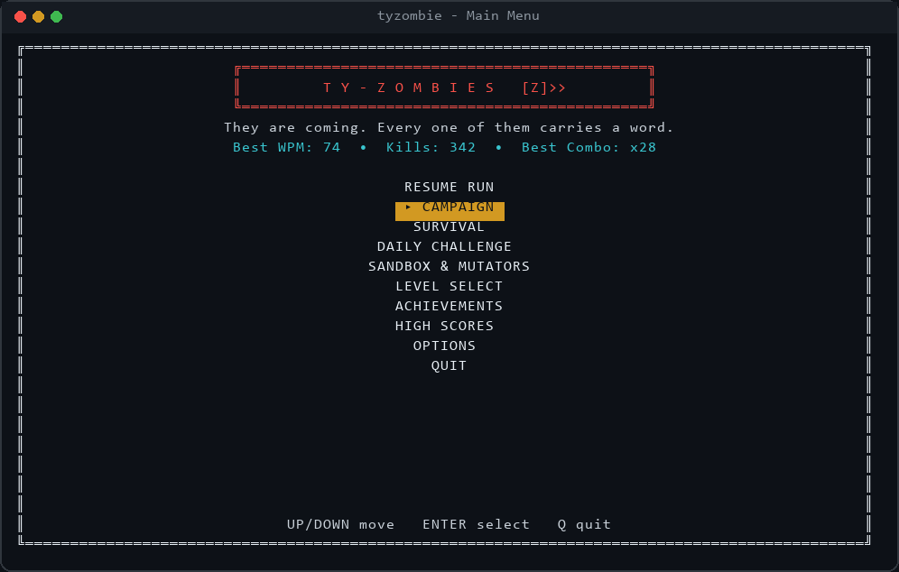
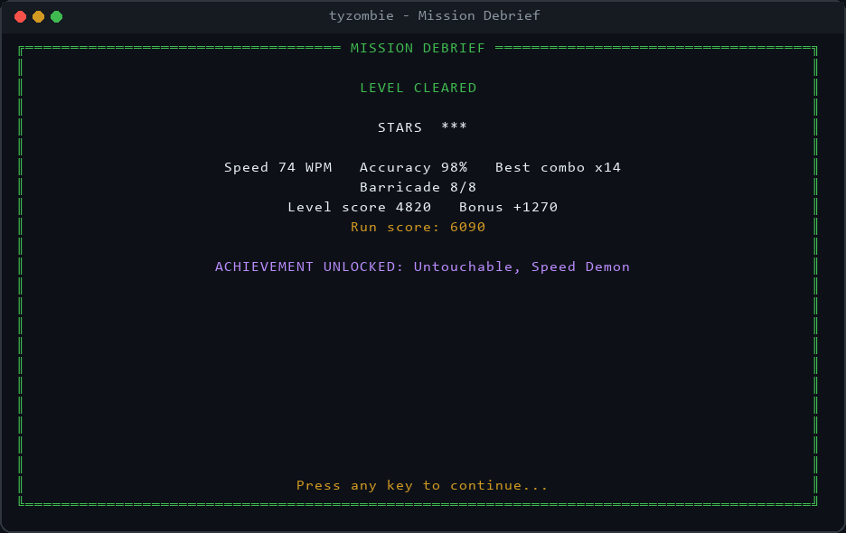
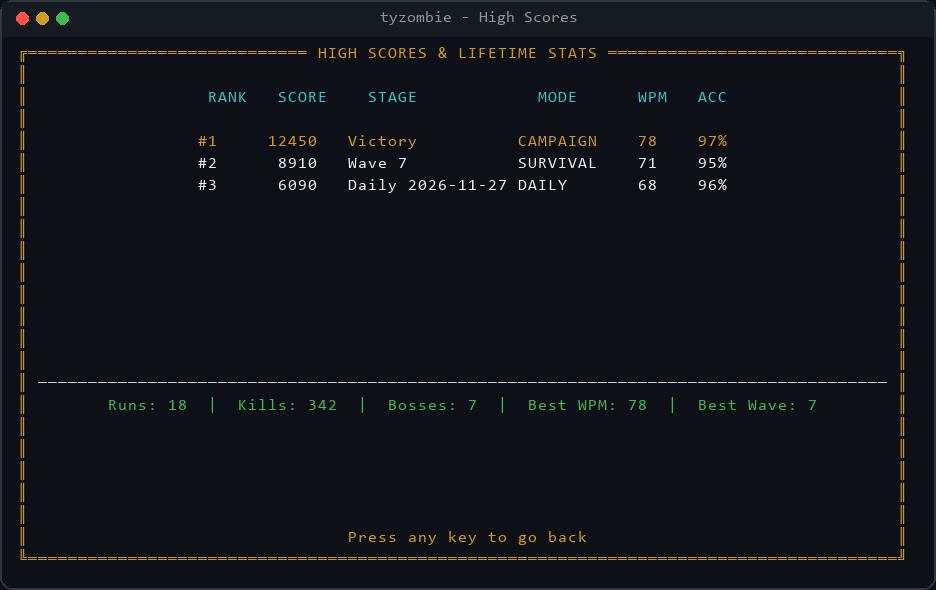
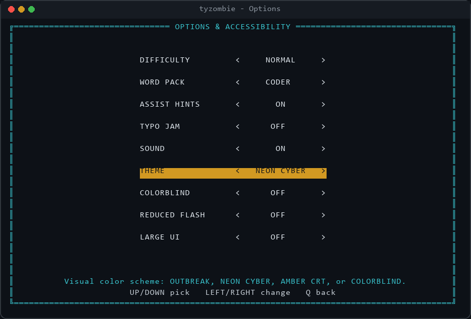

<div align="center">

# 🧟 ty-zombies

### The dead are coming. Every one of them is carrying a word.

A fast, tactical terminal typing survival game with an 8-level Campaign, Endless Survival, Daily Challenges, Seeded Sandbox with Mutators, Boss fights, Achievements, and zero-dependency cross-platform audio.


<br>



<sub>Level 6 (The City) in wide telemetry mode: Combo Fever active, Boss incoming, and live WPM/Accuracy gauges.</sub>

</div>

---

## ✨ Features

- 🎯 **Lock-On Typing**: No Enter key required—type the first letter of any word to lock onto the closest matching zombie, then finish the word to shoot.
- 🧟 **7 Zombie Types**: Walkers `[Z]`, fast Runners `[R]`, heavy Brutes `[B]`, Medics `[+]`, Frost `[*]`, Bombers `[X]`, and sentence-carrying Bosses `[BOSS]`.
- 🗺️ **4 Game Modes**:
  - **Campaign**: 8 escalating levels with 3-star ratings and unlockable Level Select.
  - **Endless Survival**: Infinite waves with a Boss every 3rd wave.
  - **Daily Challenge**: Deterministic daily seeded run (`--mode daily`) with daily tracking.
  - **Sandbox & Mutators**: Shareable seeds (`--seed`) + 4 toggleable mutators (`Hyper Horde`, `Glass Barricade`, `Dense Mist`, `Pure Typing`).
- 🔥 **Combo Fever**: Maintain a 10x+ combo for a **+25% score multiplier**.
- 🏆 **Persistent Progression**: Top-10 leaderboard, lifetime statistics, 10 unlockable achievements, mid-run auto-save & resume, and shareable ASCII/Markdown run cards (`tyzombie --record`) stored in `~/.tyzombie/data.json` (overridable via `TYZOMBIE_DATA_DIR`).
- 🔊 **Zero-Dependency Cross-Platform Audio**: Non-blocking `winsound.Beep` on Windows and synthesized PCM WAV cues (`afplay`/`paplay`/`aplay`) on macOS/Linux, with instant mute toggle.
- 🎨 **Responsive Cockpit UI & Accessibility**: Unicode box-drawn dashboard with automatic ASCII fallback, wide 2-column telemetry view (`>= 96` cols), compact `80x24` layout, 4 color themes (`OUTBREAK`, `NEON CYBER`, `AMBER CRT`, `COLORBLIND`), plus `Colorblind Mode`, `Reduced Flash`, and `Large UI` toggles.

---

## 📸 Screenshot Gallery

<table>
<tr>
<td align="center"><b>Main Menu</b><br></td>
<td align="center"><b>Mission Debrief</b><br></td>
</tr>
<tr>
<td align="center"><b>High Scores & Stats</b><br></td>
<td align="center"><b>Options & Accessibility</b><br></td>
</tr>
</table>

---

## 🚀 Installation

### Using `pipx` (Recommended)

```bash
pipx install ty-zombies
```

### Using `pip`

```bash
pip install ty-zombies
```

> **Windows note**: `windows-curses` is automatically installed on Windows as a platform dependency. If `tyzombie` is not on your `PATH` after installing with `--user`, run `python -m tyzombie setup-shell` to add a PowerShell function or Unix shell alias.

---

## 🕹️ Usage & CLI Options

```bash
# Launch the interactive menu
tyzombie

# Or run as a Python module
python -m tyzombie

# Jump directly into a mode
tyzombie --mode campaign
tyzombie --mode survival
tyzombie --mode daily
tyzombie --mode sandbox --seed 4242

# Print your latest / personal-best shareable run card
tyzombie --record

# Configure shell alias / PowerShell profile function
tyzombie setup-shell

# Check version or help
tyzombie --version
tyzombie --help
```

> 💡 Use a terminal window of at least **78 × 20** (recommended **96 × 26** for the 2-column telemetry cockpit). If the window is too small, a friendly resize overlay is displayed.

---

## 🎹 Controls

| Key | Action |
|---|---|
| `a`-`z`, `space` | Lock on and type the zombie's word |
| `Tab` | Switch target to the next closest zombie |
| `Backspace` | Drop your current target |
| `1` | **Freeze**: stops all zombies for 5 seconds |
| `2` | **Bomb**: destroys the 4 closest non-boss zombies |
| `3` | **Repair**: restores +2 barricade HP |
| `/` | **Assist**: locks onto the closest zombie (limited per level) |
| `Esc` | Pause menu (`M` to mute/unmute, `Q` to save & quit) |

---

## 🛠️ Development & Testing

```bash
git clone https://github.com/codest0411/ty-zombies.git
cd ty-zombies
python -m venv .venv
# Activate the virtual environment, then:
pip install -e ".[dev]"
pytest -v
```

Build source and wheel distributions:

```bash
python -m build
twine check dist/*
```

---

## 🔧 Troubleshooting

- **`Terminal too small` message**: Resize your terminal window to at least 78 columns by 20 rows (96×26 recommended).
- **No sound on Linux**: Ensure `paplay` (PulseAudio/PipeWire) or `aplay` (ALSA) is available on your `PATH`.
- **Save data location**: Progress is stored in `~/.tyzombie/data.json`. Set `TYZOMBIE_DATA_DIR=/custom/path` to relocate it.

---

## 📄 License

MIT License — see [LICENSE](LICENSE) for details.

<div align='center'>
Special Thanks for this Guy --> [Yup-25](https://github.com/yup-45)

Thanks Buddy !

</div>
